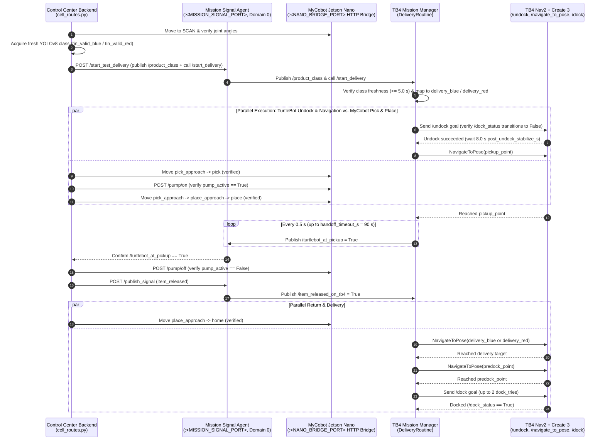
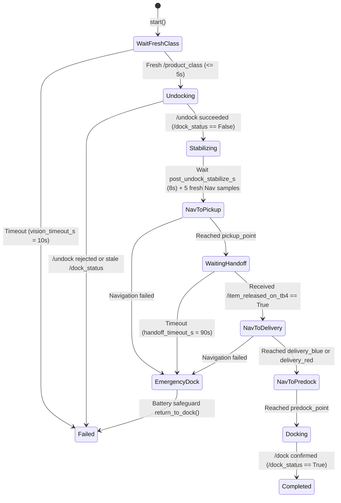

# Mission Handshake & Routine State Machines

The MyCobot 280 and the TurtleBot 4 coordinate item sorting and autonomous transport through deterministic ROS 2 topics, services, and hardware-verified gates implemented in `future_lab_control_center/backend/api/cell_routes.py` and `turtlebot4_jazzy/scripts/`.

---

## Handshake Signals (`ROS_DOMAIN_ID = 0`)

| Signal | Type | Direction | Meaning |
|---|---|---|---|
| `/product_class` | `std_msgs/msg/String` | Host (`CobotNode` / Signal Agent) → `DeliveryRoutine` | Canonical class of the identified can (`tin_valid_blue` or `tin_valid_red`). Must be fresh ($\le 5.0\text{ s}$ old). |
| `/turtlebot_at_pickup` | `std_msgs/msg/Bool` | `DeliveryRoutine` → Host (`CobotNode` / Signal Agent) | Published at `2 Hz` (`0.5 s` period) once the TurtleBot 4 reaches `pickup_point` and is waiting for item release. |
| `/item_released_on_tb4` | `std_msgs/msg/Bool` | Host (`CobotNode` / Signal Agent) → `DeliveryRoutine` | Published only after the Jetson Nano confirms `pump_active == False` at `place`. Releases the TurtleBot to navigate to its delivery zone. |
| `/turtlebot_battery_emergency` | `std_msgs/msg/Bool` | `TurtleBotNode` → `CobotNode` | Triggered if TurtleBot 4 battery drops to $\le 5\%$; forces the Cobot to roll back the held can to `pick` and return `home`. |
| `/start_delivery` | `std_srvs/srv/Trigger` | Host → `MissionManager` | Starts `DeliveryRoutine`. |
| `/start_failure` | `std_srvs/srv/Trigger` | Host → `MissionManager` | Starts `FailureRoutine` (for defective/rejected cans). |
| `/start_restock` | `std_srvs/srv/Trigger` | Host → `MissionManager` | Starts `RestockRoutine`. |
| `/stop_mission` | `std_srvs/srv/Trigger` | Host → `MissionManager` | Cancels the active routine and Nav2 goal. |
| `/save_dock_pose` | `std_srvs/srv/Trigger` | Operator / Host → `MissionManager` | Saves the current `map -> base_link` transform as `dock_station` and `predock_point` (`0.50 m` ahead) in `waypoints.yaml`. |

---

## End-to-End Cooperative Sequence Diagram

---

## Class-to-Destination Mapping

`delivery_routine.py` (`delivery_target_for_class`) and `cell_routes.py` (`_normalize_handshake_class`) map classes strictly without fallback defaults:

| Target Waypoint | Accepted Classes |
|---|---|
| `delivery_red` | `red`, `vermelho`, `vermelha`, `tin_valid_red`, `tin_valid_red_square`, `tin_valid_red_*` |
| `delivery_blue` | `blue`, `azul`, `tin_valid_blue`, `tin_valid_blue_square`, `tin_valid_blue_*` |

An unknown, empty, or stale class (`age > product_class_max_age_s` of `5.0 s`) **never defaults to a destination**: `DeliveryRoutine` refuses to start and finishes with `False` after `vision_timeout_s` (`10.0 s`).

---

## Mission Manager Routine State Machines (`turtlebot4_jazzy/scripts/`)

All three routines inherit from `MissionBase` (`turtlebot4_jazzy/scripts/mission_base.py`) and share a single-active-mission lock (`MissionManager._active_mission`) and a `180.0 s` mission watchdog timer.

### 1. `DeliveryRoutine` (`delivery_routine.py`)

### 2. `FailureRoutine` (`failure_routine.py`)

Triggered via `/start_failure` when an invalid or defective item is detected:

1. `begin_mission(watchdog_timeout_s=180.0)`
2. `undock()` → verifies fresh `/dock_status`, executes `/undock`, waits `post_undock_stabilize_s` (`8.0 s`).
3. `navigate_to("failure_pickup")` (`x = -0.453, y = 0.871, yaw = -1.620`).
4. `navigate_to("failure_zone")` (`x = -1.168, y = 2.094, yaw = 3.093`).
5. `return_to_dock()` → navigates to `predock_point` (`x = -0.608, y = -0.022, yaw = -0.008`) and executes `/dock` (up to `dock_tries = 2` attempts).

### 3. `RestockRoutine` (`restock_routine.py`)

Triggered via `/start_restock` to move stock from the inventory area back to the supply zone:

1. `begin_mission(watchdog_timeout_s=180.0)`
2. `undock()`
3. `navigate_to("inventory_point")` (`x = -1.787, y = -0.049, yaw = -3.112`).
4. `navigate_to("supply_point")` (`x = -0.573, y = 1.997, yaw = 0.025`).
5. `return_to_dock()` → `predock_point` → `/dock`.

---

## Key Parameters in `turtlebot4_jazzy/params/waypoints.yaml`

| Parameter | Default | Description |
|---|---|---|
| `frame_id` / `base_frame_id` | `map` / `base_link` | TF frames used by Nav2 and `/save_dock_pose`. |
| `dock_tries` | `2` | Maximum `/dock` action attempts after reaching `predock_point`. |
| `dock_status_max_age_s` | `3.0 s` | Maximum age of `/dock_status` before undocking or docking verification is rejected. |
| `vision_timeout_s` | `10.0 s` | How long `DeliveryRoutine` waits for a valid `/product_class` before aborting without motion. |
| `product_class_max_age_s` | `5.0 s` | Maximum age of `/product_class` accepted at mission start. |
| `handoff_timeout_s` | `90.0 s` | Maximum wait at `pickup_point` for `/item_released_on_tb4`. |
| `pickup_announce_period_s` | `0.5 s` | Publication period for `/turtlebot_at_pickup = True` while waiting at `pickup_point`. |
| `post_undock_stabilize_s` | `8.0 s` | Stabilization delay after `/undock` before sending the first Nav2 goal. |
| `nav_input_max_age_s` | `3.0 s` | Maximum allowed age for `/odom`, `/scan`, and `map -> odom -> base_link` TF. |
| `nav_input_wait_timeout_s` | `25.0 s` | Maximum wait for `nav_input_stable_samples` (`5`) consecutive valid sensor/TF checks. |

---

## Rollback & Battery Safeguards

- **Manipulator Rollback (`_rollback_handshake_cobot`)**: If the TurtleBot fails to reach `pickup_point` within `90–100 s`, or if an operator aborts the mission before the can is released, the MyCobot does **not** drop the can at `place`. Instead, it backtracks through `place_approach → pick_approach → pick`, turns the vacuum pump OFF at the table (`set_pump_verified(False)`), and returns to `home`.
- **TurtleBot Undocked Failure Safeguard (`MissionBase.finish_mission`)**: If any routine fails after undocking (`self._has_undocked == True` and `is_docked is not True`), `MissionBase` automatically invokes `return_to_dock()` before finalizing the mission so the Create 3 base does not sit undocked draining its battery.
