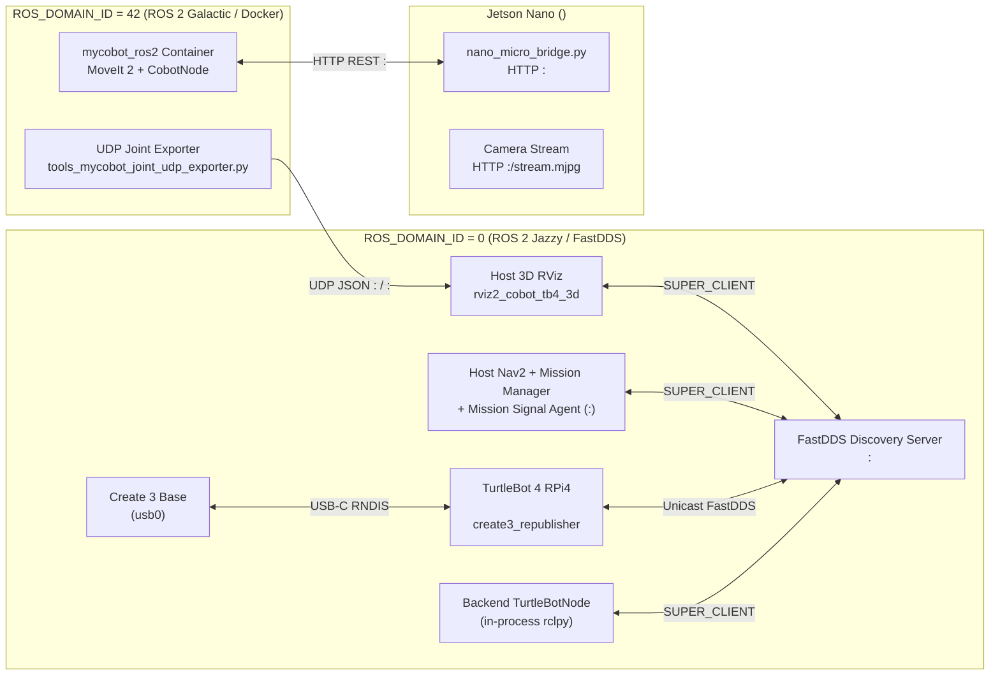

# Networking, DDS Domains & Cross-Domain Bridging

The B002 robotic cell integrates hardware running two incompatible ROS 2 distributions (**ROS 2 Jazzy Jalisco** on Ubuntu 24.04 and **ROS 2 Galactic Geochelone** on Ubuntu 20.04) across Wi-Fi (`<LAB_SUBNET_CIDR>`) and USB-Ethernet (`<CREATE3_SUBNET_CIDR>`). This page explains how DDS discovery, domain isolation, and cross-domain bridging are architected.

---

## Why Two ROS Domains Exist



### Domain 0: TurtleBot 4 & Host Navigation (`ROS 2 Jazzy`)

- **RMW Implementation**: `rmw_fastrtps_cpp` (FastDDS).
- **Discovery Mechanism**: Unicast **FastDDS Discovery Server** running on the Host Control PC at `<TURTLEBOT_IP>:<TB4_DISCOVERY_PORT>` (managed by `host_agent.py` / `turtlebot4_jazzy/start_discovery_server.sh`).
- **Why Unicast Discovery Server?** Campus and laboratory Wi-Fi routers frequently drop or rate-limit UDP multicast packets (`239.255.0.1`), causing intermittent topic disappearance with standard Simple P2P Discovery. With `ROS_DISCOVERY_SERVER="<TURTLEBOT_IP>:<TB4_DISCOVERY_PORT>;"` and `ROS_SUPER_CLIENT=True`, every node registers over deterministic unicast UDP.

### Domain 42: MyCobot MoveIt 2 & Control Center (`ROS 2 Galactic` / Hybrid)

- **Why a Separate Domain?** ROS 2 Galactic (FastDDS v2.3 / CycloneDDS v0.8) and ROS 2 Jazzy (FastDDS v2.14) have incompatible CDR/RTPS wire discovery handshakes when sharing the same domain ID and `--ipc: host` shared memory segments (`see ADR-0001`).
- **Isolation**: The `mycobot_ros2` Docker container runs on `ROS_DOMAIN_ID=42` (`cobot/mycobot_docker/docker-compose.yml`), preventing RTPS participant collisions with the TurtleBot 4 stack on `ROS_DOMAIN_ID=0`.

---

## How the Two Domains Communicate Without `ros1_bridge` or DDS Collisions

Because a single Python process can only initialize `rclpy` in one `ROS_DOMAIN_ID` and one ROS distribution, the system uses three clean, deterministic bridges:

### 1. Control Center Backend + Host Mission Signal Agent (`HTTP :<MISSION_SIGNAL_PORT>`)

- The FastAPI backend (`future_lab_control_center/backend/main.py`) runs on the Host PC in **ROS 2 Jazzy (`ROS_DOMAIN_ID=0`)** so its in-process `TurtleBotNode` and `CobotNode` can subscribe directly to `/odom`, `/scan`, `/amcl_pose`, `/dock_status`, `/battery_state`, and `/turtlebot_at_pickup`.
- For MyCobot hardware actuation, `CobotNode` talks directly to the Jetson Nano's `nano_micro_bridge.py` over **HTTP `:<NANO_BRIDGE_PORT>`** (`GET /get_angles`, `GET /move_joints`, `POST /pump/on`, `POST /pump/off`, `GET /status`) and dispatches MoveIt trajectories into the `mycobot_ros2` container via `docker exec` when MoveIt planning is active.
- For high-reliability mission signals on `ROS_DOMAIN_ID=0` (`/product_class`, `/item_released_on_tb4`, `/start_delivery`, `/stop_mission`), the Host PC runs a dedicated persistent ROS 2 Jazzy super-client daemon: `mission_signal_agent.py` listening on `127.0.0.1:<MISSION_SIGNAL_PORT>`.

### 2. Cross-Distro Joint State Mirroring Over Local UDP (`integration_cobot_tb4`)

To visualize **both** the MyCobot 280 and the TurtleBot 4 in a single ROS 2 Jazzy RViz2 window (`rviz2_cobot_tb4_3d`) on `ROS_DOMAIN_ID=0`:

1. Inside the `mycobot_ros2` container (ROS 2 Galactic, Domain 42), `integration_cobot_tb4/tools/tools_mycobot_joint_udp_exporter.py` subscribes to `/joint_states` (`sensor_msgs/msg/JointState`) and serializes the 6 joint positions as compact JSON packets over localhost UDP (`127.0.0.1:<UDP_JOINT_PORT>`).
2. On the Host PC (ROS 2 Jazzy, Domain 0), `integration_cobot_tb4/tools/tools_mycobot_joint_udp_receiver.py` listens on UDP `:<UDP_JOINT_PORT>`, re-stamps the joint angles with the host's Jazzy clock, and publishes `/mycobot/joint_states` into a dedicated `mycobot_ state_publisher` namespace (`frame_prefix: mycobot_`).
3. A static transform publisher anchors `map -> mycobot_base_link` using `integration_cobot_tb4/config/anchor.yaml` (`x=-0.338, y=1.106, z=0.800`).

> [!NOTE]
> A legacy shadow bridge also exists in `cobot/cobot_shadow_bridge/cobot_importer_jazzy.py` (UDP port `:<LEGACY_UDP_PORT>` → `/mycobot_shadow/joint_states`), superseded in the integrated 3D view by `integration_cobot_tb4/tools/tools_mycobot_joint_udp_{exporter,receiver}.py` on UDP `:<UDP_JOINT_PORT>`.

---

## Required Environment Variables for CLI Inspection

Whenever you open a new terminal on the **Host Control PC** to inspect TurtleBot 4 topics (`ros2 topic list`, `ros2 node list`), source the workspace helper so your shell connects as a FastDDS Super Client:

```bash
source /opt/ros/jazzy/setup.bash
source ~/B002_Future_Lab_Bots/turtlebot4_jazzy/setup.bash
export ROS_DOMAIN_ID=0
export RMW_IMPLEMENTATION=rmw_fastrtps_cpp
export ROS_SUPER_CLIENT=True
export ROS_DISCOVERY_SERVER="<TURTLEBOT_IP>:<TB4_DISCOVERY_PORT>;"
unset FASTDDS_BUILTIN_TRANSPORTS
unset ROS_AUTOMATIC_DISCOVERY_RANGE
```

> [!WARNING]
> Never run `ros2` CLI commands with `sudo` on the Host PC. A root-owned `_ros2_daemon` caches stale discovery state and prevents normal user shells from seeing topics on the FastDDS Discovery Server. If this happens, run `sudo pkill -f _ros2_daemon && ros2 daemon stop && ros2 daemon start`.
