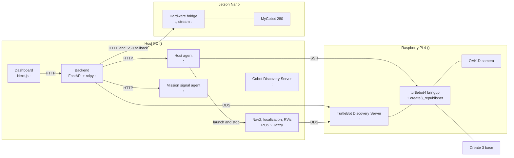

# System overview

At a high level, **B002 Future Lab Bots** combines three independent ROS 2 hardware/visualization submodules (`turtlebot4_jazzy`, `cobot`, `integration_cobot_tb4`) under a single supervisory web platform (`future_lab_control_center`). The web **Dashboard (`Next.js :<FRONTEND_PORT>`)** gives operators real-time visibility and safe control over every subsystem through the **FastAPI + rclpy Backend (`:<BACKEND_PORT>`)** and the local **Host Agent (`:<HOST_AGENT_PORT>`)**. See [Using the Web Dashboard](../guides/using-the-dashboard.md) for the operator UI guide and [Frontend Dashboard (Internals & Dev)](../reference/frontend.md) to extend the dashboard source code.

## Components

## Why the pieces are split this way

**The backend runs in Docker, but ROS 2 Jazzy processes must run on the host.**
Nav2, localization and RViz need the host's graphics and ROS installation. The
backend therefore does not start them itself. It asks the
[host agent](../reference/host-agent.md), which owns the process lifecycle.
The container uses `network_mode: host` and `ipc: host` so it can share the
network and shared memory with the host's ROS processes.

**The two robots live on different ROS stacks.** The TurtleBot uses ROS 2 Jazzy
with Fast DDS and a Discovery Server on the Raspberry Pi. The cobot uses ROS 2
Galactic in a container, with Cyclone DDS on domain 42. See
[Hardware and network](../getting-started/hardware-and-network.md).

**Telemetry is a chain, not a single source.** Battery, odometry and dock state
reach the backend through the Create 3, the `create3_republisher` on the
Raspberry Pi and DDS. A fault anywhere in that chain looks the same on the
dashboard. See [Recover TurtleBot telemetry](../guides/recover-turtlebot-telemetry.md).

## Request flow: one dashboard action

1. The browser calls the backend, for example `POST /api/v1/turtlebot/launch_nav2`.
2. The backend forwards the request to the host agent with the agent token.
3. The agent starts one process generation and waits until it is confirmed.
4. The backend returns success only when the agent confirmed it.

## Audit trail

The backend records every mutating request (`POST`, `PUT`, `PATCH`, `DELETE`)
with its path, body, status and duration, and the cobot node publishes
structured events on `/future_lab/events`. Periodic reads from the dashboard
are not recorded, to avoid noise. This supports the experiment campaign.
