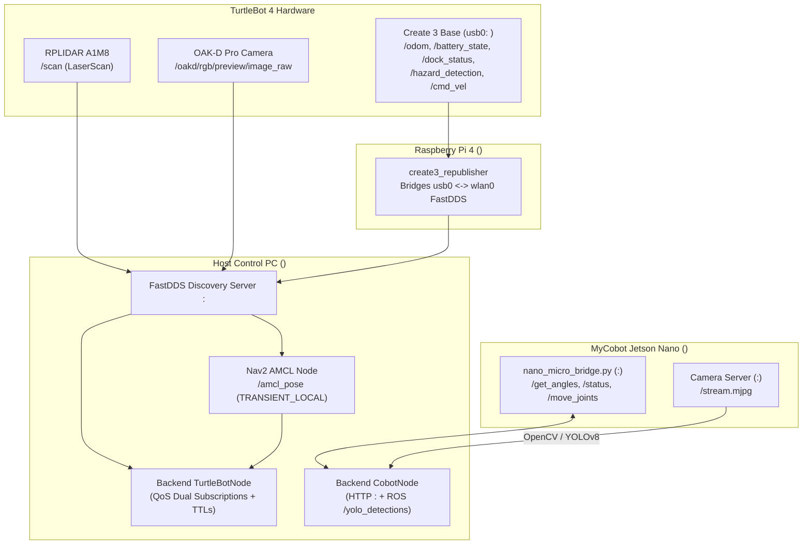

# Telemetry Pipeline & Freshness Guarantees

The B002 Control Center enforces strict **telemetry freshness TTLs** and **QoS compatibility rules** across all sensors and actuators so that neither the dashboard nor the autonomous state machine ever acts on stale cached values.

---

## End-to-End Telemetry Dataflow

---

## 1. Create 3 Internal Subnet Bridge (`create3_republisher`)

The iRobot Create 3 mobile base communicates with the Raspberry Pi 4 over an internal USB-C RNDIS Ethernet interface (`usb0`, `<CREATE3_SUBNET_CIDR>`). Because standard FastDDS unicast peers on the `<LAB_SUBNET_CIDR>` Wi-Fi network cannot route directly into `<CREATE3_BASE_IP>`:

- The Raspberry Pi runs `create3_republisher` (`turtlebot4_base`), which subscribes to Create 3 topics on `usb0` and republishes them to the FastDDS Discovery Server (`<TURTLEBOT_IP>:<TB4_DISCOVERY_PORT>`) on `wlan0`.
- **Failure Symptom**: If `create3_republisher` crashes or the Create 3 application enters Deep Sleep, `/scan` and `/oakd/*` remain visible on the Host PC, while `/odom`, `/battery_state`, and `/dock_status` stop updating.
- **Automated Detection**: `TurtleBotNode` (`backend/ros2_nodes/turtlebot_node.py`) tracks the monotonic timestamp of the last received message for each topic (`last_odom_time`, `last_battery_time`, `last_dock_time`, `last_scan_time`) and exposes `telemetry_fresh()` (requiring messages within the last `5.0 s`).

---

## 2. Dual-QoS Subscriptions for `/amcl_pose` and Sensor Streams

Different nodes in the ROS 2 Jazzy ecosystem publish with different QoS profiles:

- **Sensor Topics (`/scan`, `/odom`, `/battery_state`, `/dock_status`)**: Published with `BEST_EFFORT` or `RELIABLE` (`VOLATILE` durability). `TurtleBotNode` subscribes using `qos_profile_sensor_data` (`BEST_EFFORT`, `depth=10`), which is compatible with both `RELIABLE` and `BEST_EFFORT` publishers.
- **AMCL Pose (`/amcl_pose`)**: Nav2's `amcl` node publishes `/amcl_pose` with **`TRANSIENT_LOCAL` durability** and **`RELIABLE` reliability** (latched topic) and only emits a new message when the robot translates or rotates beyond update thresholds (`d_thresh`, `a_thresh`).
  - If a subscriber connects with `VOLATILE` durability while the robot is stationary on the dock, it never receives the latched pose until the robot moves.
  - Both `TurtleBotNode` (in the FastAPI backend) and `MissionBase` (in `turtlebot4_jazzy/scripts/mission_base.py`) register **dual subscriptions** on `/amcl_pose`:
    1. `TRANSIENT_LOCAL` + `RELIABLE` (`depth=1`) to immediately receive the latched pose upon node startup.
    2. `VOLATILE` + `BEST_EFFORT` (`depth=10`) as a fallback for custom publishers.

---

## 3. Stationary AMCL Freshness vs. Active Motion Freshness

Because `/amcl_pose` is event-driven when the robot is stationary:

- When `/amcl_pose` is received via `TRANSIENT_LOCAL` while the robot is stationary and `/scan` + `/tf` (`map -> odom -> base_link`) are actively updating (`< 3.0 s`), `TurtleBotNode` and `MissionBase` validate localization by combining the latched `/amcl_pose` with live TF lookups (`map -> base_link`).
- Before starting any navigation goal (`MissionBase._wait_for_navigation_inputs`), the robot requires:
  - Fresh `/odom` (`age <= 3.0 s`)
  - Fresh `/scan` (`age <= 3.0 s`)
  - Valid `map -> odom` and `odom -> base_link` TF transforms (`age <= 3.0 s`)
  - `5` consecutive stable readiness samples within `25.0 s` (`nav_input_wait_timeout_s`).

---

## 4. OAK-D Pro Camera Rate Limiting & Recording Exclusion

- **Dashboard Streaming**: `TurtleBotNode._oakd_callback` decodes incoming `sensor_msgs/msg/Image` (`rgb8`/`bgr8`) frames from `/oakd/rgb/preview/image_raw`, resizes them to `320×240`, encodes them as JPEG (`quality=65`), and rate-limits processing to **5 FPS** (`0.20 s` minimum interval) to prevent saturating the Host PC's GIL and CPU.
- **Experimental Rosbag Exclusion**: During 60-trial recordings (`experiments/record_trial.sh`), raw `/oakd/*` image topics are intentionally excluded from `ros2 bag record` so that high-bandwidth uncompressed video does not cause DDS packet drops on `/scan`, `/tf`, or `/amcl_pose`.

---

## 5. MyCobot Telemetry & Hardware Verification Loop

- **Joint Angles (`GET /get_angles`)**: Polled from `http://<JETSON_NANO_IP>:<NANO_BRIDGE_PORT>/get_angles`, converted from degrees to radians, and published by `CobotNode` onto `/joint_states` at `10 Hz` alongside hardware status (`mock`, `gpio_ready`, `pump_active`, `servos_released`).
- **Closed-Loop Verification**: Both `goto_pose_verified` (joint angle convergence within `0.15 rad`) and `set_pump_verified` (verifying `pump_active` in `GET /status`) ensure that physical hardware state matches software commands before advancing any mission phase.
