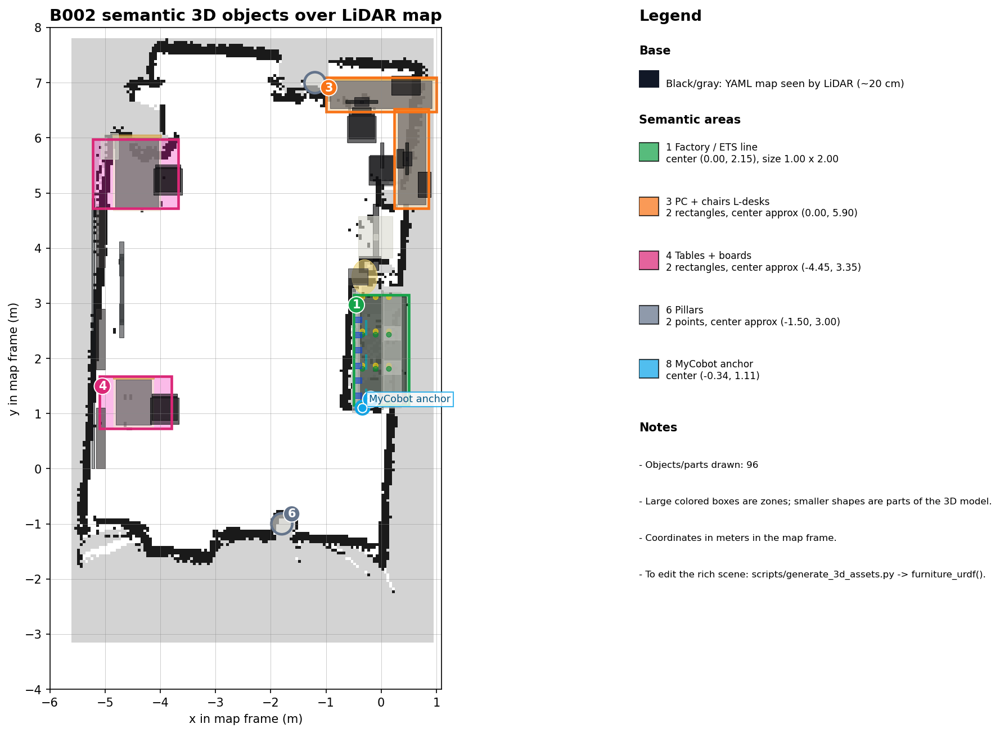

# Cell Overview

The **B002 Future Lab Bots** robotic cell is an Industry 4.0 cooperative multi-robot research and demonstration platform located in Laboratory B002. It simulates an autonomous smart-manufacturing sorting line by integrating a stationary 6-DOF manipulator (**Elephant Robotics MyCobot 280** powered by a Jetson Nano) with an autonomous mobile robot (**Clearpath / iRobot TurtleBot 4** powered by a Raspberry Pi 4 and an iRobot Create 3 base), all supervised and operated from the **Future Lab Control Center** web application on a central **Host Control PC**.

## What the Project Solves End-to-End

1. **Automated Inspection & Sorting**: Cans placed on the supply workbench are inspected overhead by a wrist camera running YOLOv8 (`best.pt`), separating valid blue cans, valid red cans, and defective/invalid items.
2. **Closed-Loop Robot-to-Robot Transfer**: Instead of blind open-loop delays, the manipulator holds the picked can above the loading point until the mobile robot confirms physical arrival at `pickup_point` (`/turtlebot_at_pickup`), and the mobile robot waits for verified vacuum release (`/item_released_on_tb4`) before driving away.
3. **Browser-First Laboratory Orchestration**: Operators do not need to manually open half a dozen SSH terminals and ROS 2 launch files. From `http://localhost:3000`, the **Control Center Dashboard** brings up Nav2/AMCL, MoveIt 2, 3D RViz visualization, live camera feeds, Teach Mode pose calibration, manual D-Pad driving, safety/panic stops, and real-time terminal logs.
4. **Reproducible Research Telemetry**: Every run can be captured alongside Zstd MCAP rosbags, `1 Hz` dashboard snapshots, and `future_lab.event.v1` audit trails for obstacle-avoidance benchmarking (`60-trial protocol`).

---

## 5-Minute Tour of the Cell

### Physical Arena & Coordinate Anchor

The laboratory floor map (`turtlebot4_jazzy/maps/Mapa_Lab.yaml`) serves as the global `map` frame for both navigation and 3D visualization:

- **MyCobot Table & Base Anchor**: The manipulator sits on a table (`0.90 m × 0.70 m × 0.80 m`) anchored at `x = -0.338 m`, `y = 1.106 m`, `z = 0.800 m` (`yaw = 0.0 rad`) in the `map` frame (`integration_cobot_tb4/config/anchor.yaml`).
- **Pickup Point (`pickup_point`)**: Located directly in front of the MyCobot table at `x = -0.025 m`, `y = 0.896 m` (`yaw = 3.139 rad`), where the TurtleBot 4 halts to receive cans from the manipulator's vacuum suction gripper.
- **Charging Dock (`dock_station` & `predock_point`)**: The Create 3 infrared charging station at `x = 0.068 m`, `y = -0.004 m`, with a pre-dock staging pose at `x = -0.608 m`, `y = -0.022 m`.
- **Sorting Destinations**:
  - `delivery_blue` (`x = -2.238 m`, `y = 1.889 m`): drop-off zone for valid blue cans (`tin_valid_blue*`).
  - `delivery_red` (`x = -2.357 m`, `y = 0.793 m`): drop-off zone for valid red cans (`tin_valid_red*`).
  - `failure_pickup` (`x = -0.453 m`, `y = 0.871 m`) and `failure_zone` (`x = -1.168 m`, `y = 2.094 m`): staging and quarantine zones for rejected items.
  - `inventory_point` (`x = -1.787 m`, `y = -0.049 m`) and `supply_point` (`x = -0.573 m`, `y = 1.997 m`): waypoints used by the autonomous restock routine.

---

## The Four Compute Nodes

| Node | Hardware & OS | ROS Distribution & RMW | Primary Role |
| :--- | :--- | :--- | :--- |
| **Host Control PC** (`192.168.0.129`) | Ubuntu 24.04 LTS (`x86_64`) | ROS 2 Jazzy (`Domain 0`, FastDDS) + Dockerized ROS 2 Galactic (`Domain 42`) | Runs the FastDDS Discovery Server (`:11811`), Control Center stack (`:8000` / `:3000`), Host Agent (`:18080`), Mission Signal Agent (`:18081`), Nav2/RViz, and MoveIt 2. |
| **MyCobot 280** (`192.168.0.62` Wi-Fi / `.250` ETH) | Jetson Nano (`aarch64`), Ubuntu 20.04 | ROS 2 Galactic (`Domain 42`) + HTTP Micro-Bridge (`:8088`) | Drives the 6 servo joints over `/dev/ttyTHS1` (`1000000` baud), controls the GPIO suction pump (BCM pins `20` and `21`), and streams wrist-camera MJPEG video (`:8080/stream.mjpg`). |
| **TurtleBot 4 Companion** (`192.168.0.21`) | Raspberry Pi 4B (`aarch64`), Ubuntu 24.04 | ROS 2 Jazzy (`Domain 0`, FastDDS) | Interfaces with the RPLIDAR and OAK-D Pro camera, runs `create3_republisher` to bridge telemetry across subnet namespaces, and forwards topics to the Discovery Server. |
| **iRobot Create 3 Base** (`192.168.186.2` USB) | Embedded mobile base (`usb0`) | ROS 2 Jazzy internal firmware (`rmw_fastrtps_cpp`) | Executes low-level wheel odometry, safety cliff/bumper reflexes, and autonomous IR docking (`/dock` and `/undock` actions). |

---

## End-to-End Cooperative Cycle

A complete sorting mission follows an 8-stage hardware-verified workflow:

1. **Inspection (`SCAN`)**: The MyCobot moves to the `scan` pose above the supply table and inspects the object using the wrist camera and YOLOv8 model (`best.pt`).
2. **Classification & Proactive Dispatch**: Once a valid blue or red can is classified (`tin_valid_blue` or `tin_valid_red`), the Host PC publishes `/product_class` and triggers `/start_delivery` on the Mission Manager.
3. **Parallel Undock & Pick**: While the TurtleBot 4 undocks from its charging station and navigates to `pickup_point`, the MyCobot executes `pick_approach → pick`, activates the vacuum pump, and moves through `pick_approach → place_approach → place` (holding the can above the loading point).
4. **Arrival Handshake (`/turtlebot_at_pickup`)**: Upon reaching `pickup_point`, the TurtleBot 4 publishes `True` on `/turtlebot_at_pickup` every `0.5 s` and waits up to `90 s` (`handoff_timeout_s`) for release confirmation.
5. **Vacuum Release (`/item_released_on_tb4`)**: Only after verifying `/turtlebot_at_pickup == True` does the MyCobot turn the suction pump off (`set_pump_verified(False)`), depositing the can onto the TurtleBot 4 tray, and publish `True` on `/item_released_on_tb4`.
6. **Manipulator Return (`HOME`)**: The MyCobot retracts safely through `place_approach → home` while the TurtleBot begins its delivery leg.
7. **Autonomous Delivery**: The TurtleBot 4 navigates via Nav2 to `delivery_blue` or `delivery_red` depending on the fresh `/product_class` classification.
8. **Return & Dock**: After reaching the delivery target, the TurtleBot 4 navigates back to `predock_point` and executes the `/dock` action until physical charging contact is confirmed on `/dock_status`.

---

## Next Steps

- Check physical wiring, IP addresses, and DDS domains in [Hardware and Network](hardware-and-network.md).
- Bring up the stack and verify health indicators in [Installation and First Run](install-and-first-run.md).
- Run your first simulated and physical sorting cycle in [First Delivery Mission](first-delivery-mission.md).
