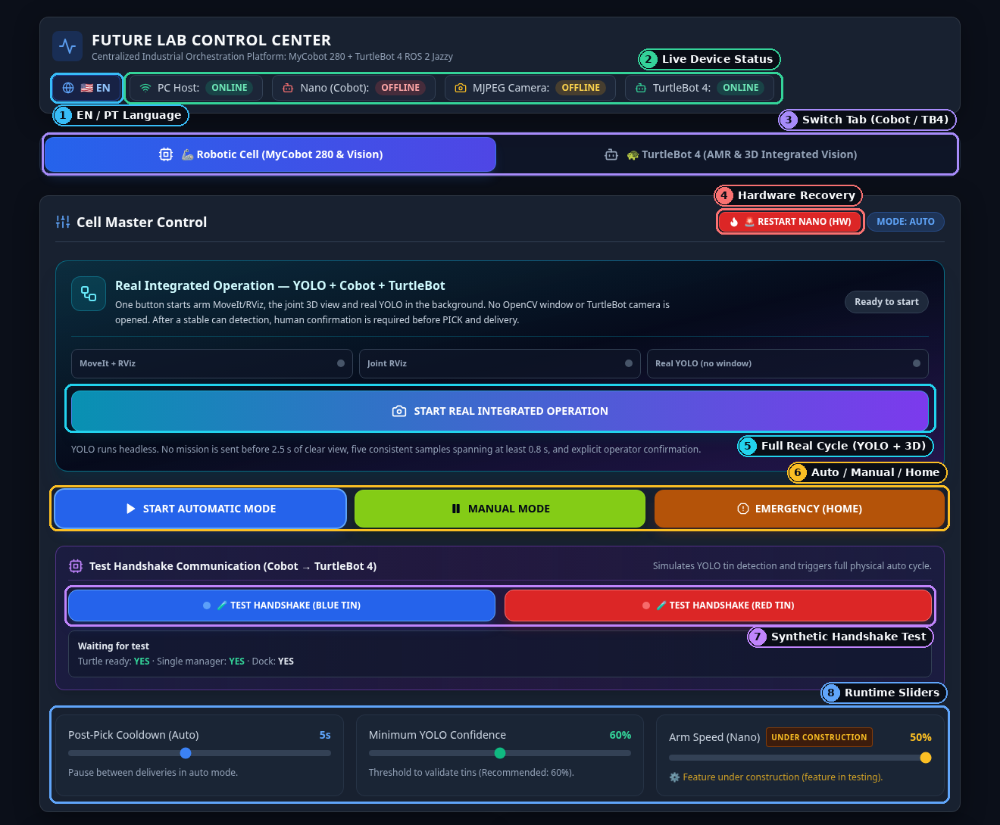
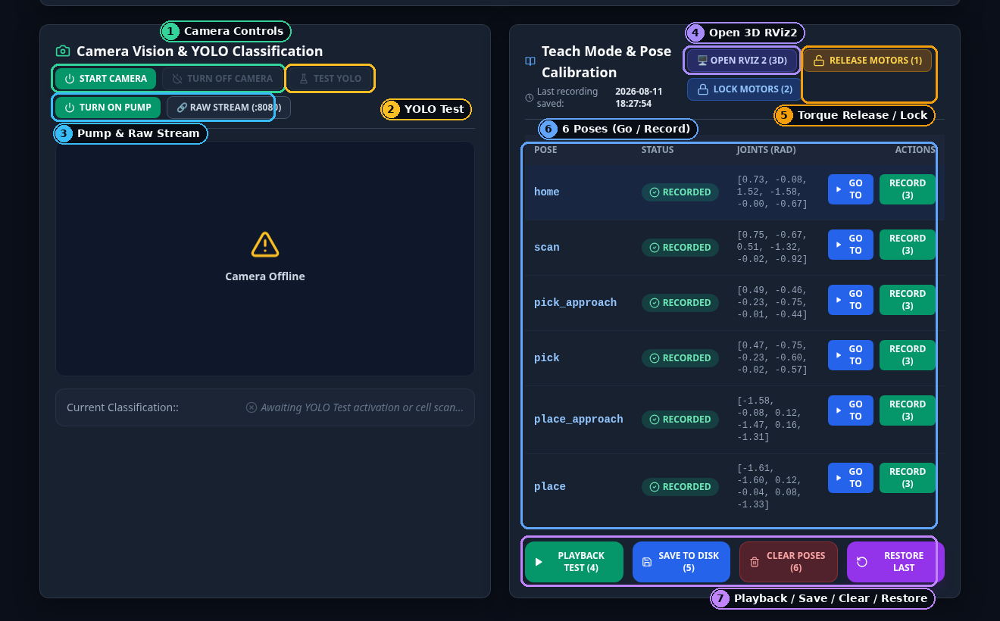
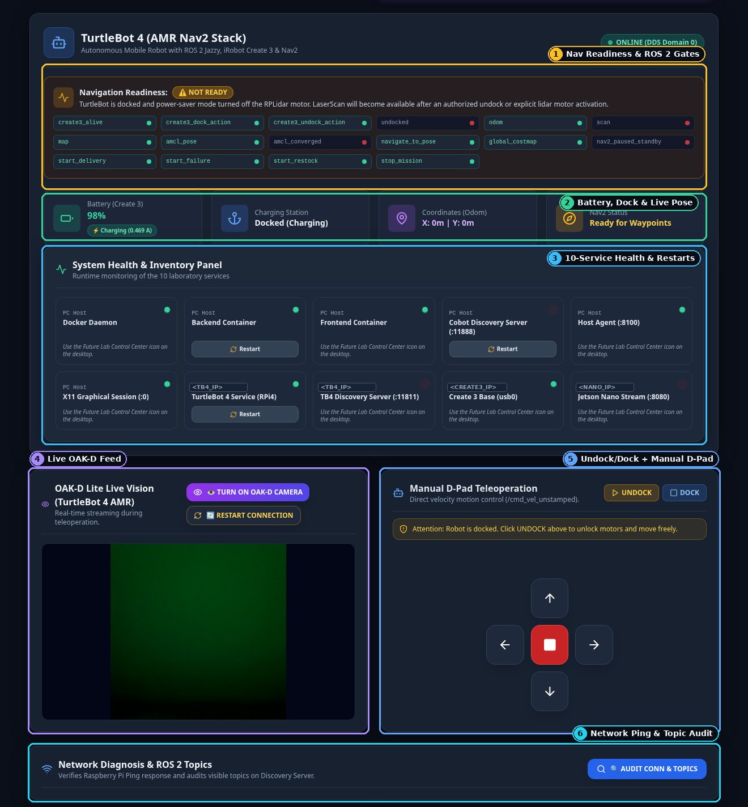
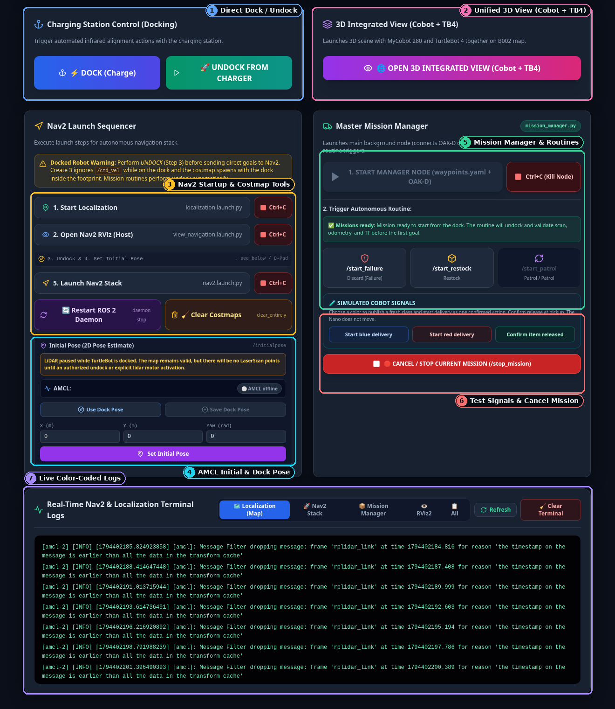

# Using the Web Control Center Dashboard

The **Future Lab Control Center Dashboard** (`http://localhost:<FRONTEND_PORT>`) lets anyone operate both the **MyCobot 280** robotic arm and the **TurtleBot 4** mobile robot from a web browser—without needing to memorize ROS 2 commands or open multiple terminals.

This guide uses annotated screenshots of the live interface so you can locate every button, indicator, and workflow at a glance.

For internal React/Next.js architecture and instructions on modifying the source code, see [Frontend Dashboard: Internals & Developer Guide](../reference/frontend.md).

---

## 1. Opening the Dashboard

- **On the Lab Control PC**: Open Chrome or Firefox at `http://localhost:<FRONTEND_PORT>` after starting the lab (`./START_CONTROL_CENTER.sh` or `./future_lab_control_center/START_LAB.sh`).
- **From Another Computer (Lab Wi-Fi or Tailscale VPN)**: Open `http://<HOST_PC_IP>:<FRONTEND_PORT>` (for example, `http://<TURTLEBOT_IP>:<FRONTEND_PORT>` inside the lab or `http://<TAILSCALE_HOST_IP>:<FRONTEND_PORT>` over Tailscale). The dashboard automatically connects to the backend on port `:<BACKEND_PORT>` at that same address.

---

## 2. Top Bar, Tabs & Cell Master Control (`Tab 1`)

Use the numbered callouts in the screenshot above as your quick map:

| # | Area / Button | What It Does & How to Use It |
| :-: | :--- | :--- |
| **1** | **EN / PT Language Toggle** | Switches all labels, alerts, and backend status messages instantaneously between **English** and **Portuguese** (saved in browser `localStorage`). |
| **2** | **Live Device Status Badges** | Shows live health every `2 s`: **`PC Host`** (FastAPI backend `:<BACKEND_PORT>`), **`Nano (Cobot)`** (Jetson Nano bridge `:<NANO_BRIDGE_PORT>`), **`MJPEG Camera`** (`:<CAMERA_STREAM_PORT>/stream.mjpg`), and **`TurtleBot 4`** (RPi4 telemetry / Discovery Server). |
| **3** | **Workspace Tab Switcher** | Switches between **Robotic Cell (`MyCobot 280 & Vision`)** and **TurtleBot 4 (`AMR & 3D Integrated Vision`)** without interrupting background monitoring. |
| **4** | **Hardware Recovery (`RESTART NANO HW`)** | Emergency hardware reset for the manipulator: locks servos safely, frees `/dev/ttyTHS1`, restarts the Nano bridge + camera, and relaunches MoveIt 2 while displaying the 5-step progress modal. |
| **5** | **Real Integrated Operation** | **Recommended one-click full mission.** Starts MoveIt + RViz, unified 3D view, and headless YOLOv8 inspection (`MoveIt + RViz`, `Joint RViz`, `Real YOLO` pills turn green). Once a valid can is confirmed (`5` consistent samples), an amber banner asks you to click **Confirm & Execute** before the robot moves. Enabled only when `Turtle ready: YES` and `Single manager: YES`. |
| **6** | **Auto / Manual / Emergency Home** | **`START AUTOMATIC MODE`** runs continuous sorting loops. **`MANUAL MODE`** reveals the 3-step human approval bar (`1. Go to SCAN` → `2. Authorize PICK` → `3. Authorize PLACE`). While *any* cycle is running, this middle button pulses orange as **`INTERRUPT OPERATION`** to pause mid-motion. **`EMERGENCY (HOME)`** halts the cycle and returns the arm safely to `home`. |
| **7** | **Synthetic Handshake Test (`Blue` / `Red`)** | Runs a full physical pick-place-deliver-dock test using a simulated YOLO label (`tin_valid_blue` or `tin_valid_red`)—ideal for verifying robot coordination before testing with live vision. |
| **8** | **Runtime Sliders** | Adjusts **`Post-Pick Cooldown`** (`1–10 s` pause between auto cycles), **`Minimum YOLO Confidence`** (`30–90%`, `60%` recommended), and **`Arm Speed`** cap. |

### Step-by-Step: Manual Approval Bar (`MANUAL MODE`)

When you click **`MANUAL MODE`** (`#6`), a 3-step approval strip opens directly below the mode buttons:

1. **Step 1 — Go to SCAN**: Moves the MyCobot arm above the supply table and turns on YOLOv8 vision.
2. **Step 2 — Authorize PICK**: Lights up green as soon as a valid blue or red can is detected (`Waiting YOLO detection...` clears). Clicking it picks up the can and carries it to `place_approach`.
3. **Step 3 — Authorize PLACE**: Lights up blue once the arm arrives above the TurtleBot tray. Clicking it triggers the TurtleBot 4 handoff, releases the vacuum pump, and returns the arm to `home`.

---

## 3. Wrist Camera, Suction Pump & Pose Calibration (`Tab 1` Bottom)

| # | Area / Button | What It Does & How to Use It |
| :-: | :--- | :--- |
| **1** | **Camera Controls** | **`START / RESTART CAMERA`** launches or restarts `nano_camera_server.py` on `:<CAMERA_STREAM_PORT>` and automatically retries frames (`7–16 s`). **`TURN OFF CAMERA`** stops the video stream cleanly. |
| **2** | **YOLO Test Toggle** | Runs live standalone YOLOv8 object classification on the wrist-camera feed and displays the detected class (`Blue Tin`, `Red Tin`, etc.) and confidence `%` in the classification bar below the video. |
| **3** | **Pump & Raw Stream** | **`TURN ON / OFF PUMP`** directly toggles the pneumatic suction cup with instant optimistic feedback. **`RAW STREAM (:<CAMERA_STREAM_PORT>)`** opens the direct MJPEG feed in a new browser tab. |
| **4** | **Open 3D RViz2** | Opens the manipulator's MoveIt 2 + RViz2 3D window on the Host Control PC desktop. |
| **5** | **Torque Release / Lock** | Used for hand-guiding calibration: hold the arm with one hand, click **`RELEASE MOTORS (1)`**, move the arm physically to the target spot, then click **`LOCK MOTORS (2)`** to hold it in place. |
| **6** | **6 Required Poses Table** | Displays `home`, `scan`, `pick_approach`, `pick`, `place_approach`, and `place` with **`RECORDED / PENDING`** badges and joint angles (rad). Click **`RECORD (3)`** to capture the current arm posture, or **`GO TO`** to test moving safely to a saved pose. |
| **7** | **Calibration Actions** | **`PLAYBACK TEST (4)`** steps through all recorded poses in sequence. **`SAVE TO DISK (5)`** writes `cobot_poses.yaml` (creating an automatic `.bak` backup). **`CLEAR POSES (6)`** clears poses; **`RESTORE LAST`** reverts to the `.bak` backup. |

> [!IMPORTANT]
> While **Auto Mode** is actively running (`auto_running == true`), the entire **Teach Mode & Pose Calibration** card locks automatically with an amber banner so nobody can accidentally release motor torque mid-cycle.

---

## 4. TurtleBot 4 Telemetry, OAK-D Video & Manual Driving (`Tab 2` Top)

Switch to the **`TurtleBot 4 (AMR & 3D Integrated Vision)`** tab (`#3` in the top bar) to inspect and drive the mobile robot directly:

| # | Area / Button | What It Does & How to Use It |
| :-: | :--- | :--- |
| **1** | **Navigation Readiness & ROS 2 Gates** | Instant green/red checklist showing whether `create3_alive`, `odom`, `scan`, `map`, `amcl_pose`, `amcl_converged`, `navigate_to_pose`, `global_costmap`, and the 4 Mission Manager services (`/start_delivery`, `/start_failure`, `/start_restock`, `/stop_mission`) are active. Explains why readiness is blocked (for instance, when LIDAR power-saver is active while docked). |
| **2** | **Battery, Dock & Live Pose Cards** | Displays live Create 3 **`Battery %` & charging current (`A`)**, **`Charging Station`** (`Docked` vs. `Undocked`), **`Coordinates (Odom)`** `(X, Y)`, and **`Nav2 Status`**. |
| **3** | **10-Service Health & Inventory** | Monitors all 10 laboratory services (`Docker Daemon`, `Backend`, `Frontend`, `Cobot Discovery`, `Host Agent :<HOST_AGENT_PORT>`, `X11 Session`, `TurtleBot 4 Service RPi4`, `TB4 Discovery :<TB4_DISCOVERY_PORT>`, `Create 3 Base`, `Jetson Nano Stream`) with one-click **`Restart`** buttons where supported. |
| **4** | **OAK-D Live Vision Feed** | Streams the TurtleBot 4 front OAK-D Lite camera (`GET /api/v1/turtlebot/camera_feed`). Use **`TURN ON OAK-D CAMERA`** or **`RESTART CONNECTION`** if the feed is offline. |
| **5** | **Quick Undock/Dock & Manual D-Pad** | **`UNDOCK`** / **`DOCK`** quick actions plus directional arrow buttons for manual driving (`+0.25 m/s` forward/back, `±0.6 rad/s` turn left/right) and the red center **Stop** button (`0, 0`). *Note: Create 3 ignores drive commands while docked—click `UNDOCK` first.* |
| **6** | **Network Diagnosis (`AUDIT CONN & TOPICS`)** | Pings `<TURTLEBOT_IP>` and counts live ROS 2 topics visible on the FastDDS Discovery Server. |

---

## 5. Docking, Unified 3D View, Nav2 Startup, Missions & Logs (`Tab 2` Bottom)

Scroll down in the **TurtleBot 4** tab to access autonomous navigation bringup, AMCL pose initialization, mission routines, and real-time logs:

| # | Area / Button | What It Does & How to Use It |
| :-: | :--- | :--- |
| **1** | **Charging Station Control** | Large **`DOCK (Charge)`** and **`UNDOCK FROM CHARGER`** action buttons for infrared station docking. |
| **2** | **3D Integrated View (`Cobot + TB4`)** | Launches the unified Digital Twin (`rviz2_cobot_tb4_3d`) on the Host PC showing both the MyCobot 280 and TurtleBot 4 inside Lab B002 (`integration_cobot_tb4`). |
| **3** | **Nav2 Launch Sequencer & Costmap Tools** | Guides safe mobile navigation bringup in exact order: **`1. Start Localization`** (`localization.launch.py`) → **`2. Open Nav2 RViz`** → *(Steps 3 & 4 Undock & Initial Pose)* → **`5. Launch Nav2 Stack`** (`nav2.launch.py`), each paired with a **`Ctrl+C`** stop button. Below them sit **`Restart ROS 2 Daemon`** and **`Clear Costmaps`** (to erase phantom obstacles). |
| **4** | **AMCL Initial Pose (`/initialpose`)** | Initializes localization on the lab map. When the robot is on the charging dock, simply click **`Use Dock Pose`** followed by **`Set Initial Pose`** and confirm the **`AMCL`** pill turns converged. Use **`Save Dock Pose`** only if the physical dock moved. |
| **5** | **Master Mission Manager** | Starts or kills `mission_manager.py`, displays **`Missions ready`** status, and lets you trigger **`/start_failure`**, **`/start_restock`**, or **`/start_patrol`**. |
| **6** | **Simulated Cobot Signals & Cancel Mission** | Lets you test the TurtleBot 4 delivery loop independently (**`Start blue delivery`**, **`Start red delivery`**, **`Confirm item released`**) without moving the MyCobot arm. **`CANCEL / STOP CURRENT MISSION`** calls `/stop_mission` immediately. |
| **7** | **Real-Time Terminal Logs** | Live color-coded log viewer (`INFO` green, `WARN` amber, `ERROR` red) with source filter tabs (**Localization**, **Nav2 Stack**, **Mission Manager**, **RViz2**, **All**), **`Refresh`**, and **`Clear Terminal`**. |

---

## 6. Global Safety & Progress Popups

These full-screen modals protect hardware and keep the operator informed regardless of which tab is open:

| Modal | When It Appears | What You Should Do |
| :--- | :--- | :--- |
| **`PanicOverlayModal`** | Appears in bright red whenever **`panic_locked === true`** (suction pump OFF, MoveIt/camera stopped, motors locked). | Visually confirm the table and floor are safe and clear, then click **Reset Panic & Restart Hardware**. |
| **`InterruptOverlayModal`** | Appears when you click **`INTERRUPT OPERATION`** mid-cycle. | Click **`Abort Operation`** (`abort: true` — returns any held can safely to `pick` and sends the arm `home`) or **`Resume Operation`** (`abort: false` — resumes from the interrupted step). |
| **`RebootOverlayModal`** | Appears after clicking **`RESTART NANO (HW)`**, showing a 5-stage progress bar (`~14 s`). | Wait for the bar to reach 100%; it closes automatically once fresh telemetry resumes. |
| **`NotificationToast`** | Floating banner in the top-right corner on every action result or error (auto-dismisses after `15 s`). | Check confirmation or warning details (automatically translated into English when `EN` is selected). |
