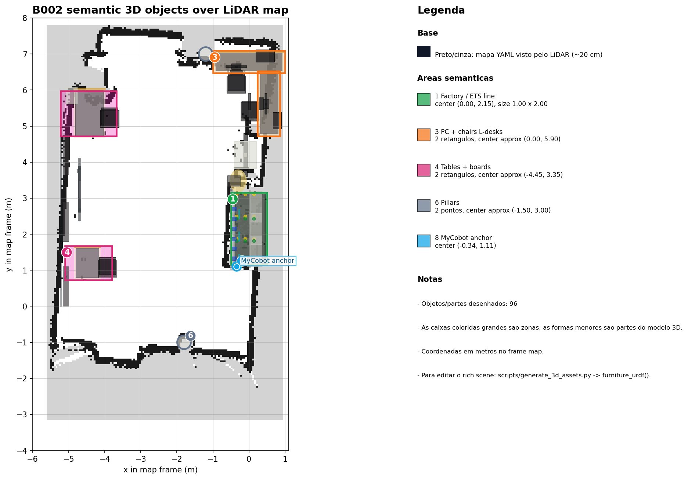

# B002 Future Lab Bots

Welcome to the technical documentation and maintainer handbook for the **B002 Future Lab** cooperative robotic cell: an **iRobot / Clearpath TurtleBot 4** mobile robot and an **Elephant Robotics MyCobot 280** 6-DOF manipulator that collaborate to inspect, sort, and transport cans, orchestrated through a unified web control center.

## What the System Does

- **Vision Inspection & Pick-and-Place (`MyCobot 280` + `Jetson Nano`)**: Moves to an overhead `scan` posture, classifies cans using a YOLOv8 vision model (`tin_valid_blue` vs. `tin_valid_red`), picks the item with a pneumatic suction cup, and stages it at the handoff pose (`place`).
- **Autonomous Mobile Transport (`TurtleBot 4` + `Nav2`)**: Undocks from its infrared charging station, navigates to `pickup_point`, performs a closed-loop ROS 2 handoff (`/turtlebot_at_pickup` ↔ `/item_released_on_tb4`), delivers the can to `delivery_blue` or `delivery_red`, and returns to its dock.
- **Unified Control Center (`FastAPI` + `Next.js 14` + `Host Agent`)**: Supervises multi-domain DDS discovery (`Domain 0` Jazzy + `Domain 42` Galactic), enforces telemetry freshness gates, renders a 3D Digital Twin in RViz2, and records auditable 60-trial experimental campaigns.

---

## Where to Start

| If you want to... | Read |
|---|---|
| Take a 5-minute tour of the arena, compute nodes, and cycle | [Cell overview](getting-started/overview.md) |
| Understand the hardware wiring, IPs, and DDS domains | [Hardware and network](getting-started/hardware-and-network.md) |
| Install and bring up the Control Center | [Install and first run](getting-started/install-and-first-run.md) |
| Run your first cooperative sorting mission | [First delivery mission](getting-started/first-delivery-mission.md) |
| Operate the lab day to day | [Start and stop the lab](guides/start-and-stop-the-lab.md) |
| Calibrate MyCobot poses or TurtleBot localization | [Calibrate Cobot poses](guides/calibrate-cobot-poses.md) · [Set initial & dock pose](guides/set-initial-pose-and-dock-pose.md) |
| Stop a robot right now | [Emergency stop](guides/emergency-stop.md) |
| Diagnose a failure or symptom | [Troubleshooting](troubleshooting.md) · [Known issues](known-issues.md) |
| Look up a REST route, ROS topic, script, or submodule | [REST API](reference/rest-api.md) · [ROS interfaces](reference/ros-interfaces.md) · [Scripts](reference/scripts.md) · [Repository map](reference/repository-map.md) |
| Understand the architecture and design decisions | [System overview](architecture/system-overview.md) · [Mission handshake](architecture/mission-handshake.md) · [Decision records](architecture/decisions/index.md) |
| Run or analyze the 60-trial experiment campaign | [Run experiment trials](guides/run-experiment-trials.md) · [60-trial protocol](research/trial-protocol.md) · [Audit logging](research/audit-logging.md) |
| Update or contribute to these docs | [How to edit these docs](contributing/how-to-edit-these-docs.md) · [Style guide](contributing/style-guide.md) |

---

## How This Documentation Is Organized

The site follows the [Diataxis](https://diataxis.fr/) structure so every page has a clear purpose:

| Quadrant | Purpose | Section |
|---|---|---|
| **Tutorials** | Onboarding and first end-to-end walkthroughs | `Getting started` |
| **How-To Guides** | Step-by-step operational, calibration, and recovery runbooks | `Guides` & `Troubleshooting` |
| **Reference** | Exact specifications of APIs, ROS interfaces, scripts, and submodules | `Reference` & `Glossary` |
| **Explanation & Research** | Architectural rationale, ADRs, and experimental methodology | `Architecture` & `Research` |
