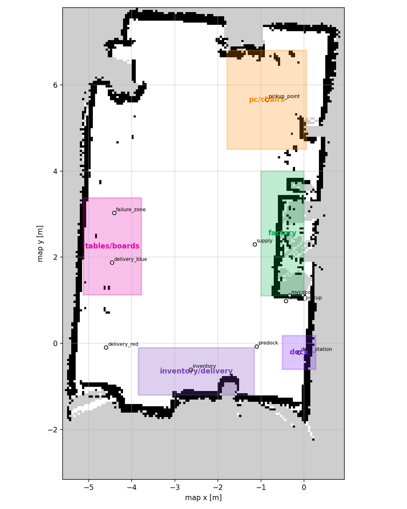

# Submodule Reference: `integration_cobot_tb4`

- **Repository URL**: `git@github.com:B002-FUTURE-LAB/integration_cobot_tb4.git`
- **Mount Path**: `integration_cobot_tb4/`
- **ROS Distribution**: Host **ROS 2 Jazzy** (`ROS_DOMAIN_ID=0`) + Exporter in **ROS 2 Galactic** (`ROS_DOMAIN_ID=42`)
- **Purpose**: Unified 3D Digital Twin combining the TurtleBot 4 navigation stack, the MyCobot 280 URDF/joint states, and the semantic 3D geometry of Lab B002 in a single RViz2 scene.

---

## Visual Overview



---

## Directory Layout

```text
integration_cobot_tb4/
├── config/
│   ├── anchor.yaml                       # Static transform map -> mycobot_base_link & table dimensions
│   ├── b002_scene.yaml                   # Semantic 3D scene definition (walls, tables, zones, mode)
│   └── cobot_tb4_3d.rviz                 # Unified RViz2 configuration file
├── generated/
│   ├── b002_dual_lab.sdf                 # Generated Gazebo SDF world with both robots and furniture
│   ├── b002_scene_2d_overview.png        # 2D annotated top-down map of Lab B002
│   └── b002_semantic_preview.png         # 3D isometric preview of semantic markers
├── scripts/
│   ├── start_3d_monitoring.sh            # Full launcher: TF anchor + UDP joint bridge + markers + RViz2
│   ├── start_3d_rviz_only.sh             # Launches unified RViz2 + scene markers without hardware bridge
│   ├── calibrate_cobot_anchor.sh         # Updates map -> mycobot_base_link coordinates in anchor.yaml
│   └── generate_b002_dual_views.sh       # Rebuilds generated PNG previews and SDF world from YAML
└── tools/
    ├── tools_mycobot_joint_udp_exporter.py  # Runs in mycobot_ros2 (Galactic) -> UDP 127.0.0.1:38527
    ├── tools_mycobot_joint_udp_receiver.py  # Runs on Host (Jazzy) <- UDP :38527 -> /mycobot/joint_states
    ├── b002_scene_marker_publisher.py       # Publishes /b002/scene_markers (visualization_msgs/MarkerArray)
    └── generate_b002_dual_assets.py         # Asset generator for 2D/3D previews and SDF
```

---

## Coordinate Anchor (`config/anchor.yaml`)

To place the MyCobot 280 accurately inside the TurtleBot 4's SLAM map (`map` frame), `start_3d_monitoring.sh` reads `config/anchor.yaml` and starts a `tf2_ros/static_transform_publisher` for `map -> mycobot_base_link`:

```yaml
parent_frame: map
child_frame: mycobot_base_link
x: -0.338416188955307
y: 1.1060110330581665
z: 0.80
roll: 0.0
pitch: 0.0
yaw: 0.0
table:
  enabled: true
  height_m: 0.80
  size_x_m: 0.90
  size_y_m: 0.70
```

Because the MyCobot URDF links share common names like `base_link` with the TurtleBot 4, `start_3d_monitoring.sh` launches a dedicated `robot_state_publisher` in the `/mycobot` namespace with `frame_prefix: mycobot_`, subscribing to `/mycobot/joint_states`.

---

## Semantic Scene Modes (`config/b002_scene.yaml`)

`b002_scene_marker_publisher.py` publishes 3D markers on `/b002/scene_markers` with two selectable visual profiles:

- **`rich` (Default)**: Renders the manipulator table (`0.90 × 0.70 × 0.80 m`), workbenches, structural walls extracted from `Mapa_Lab.pgm`, floor zone overlays (`pickup_point`, `delivery_blue`, `delivery_red`, `failure_zone`, `inventory_point`, `supply_point`), and floating 3D text labels.
- **`minimal`**: Renders only essential reference markers (`mycobot_table`, dock marker, and waypoint rings) for low-GPU remote sessions.

---

## Launching and Calibrating

### Launch from Control Center Dashboard

In the **TurtleBot 4** tab (`http://localhost:3000`), click **Launch 3D View** (`POST /api/v1/turtlebot/launch/integrated_3d`). It is also started automatically as step 2 of **Integrated Real Mode** (`POST /api/v1/cell/integrated_real/start`).

### Launch from CLI

```bash
cd /home/future-lab/B002_Future_Lab_Bots/integration_cobot_tb4
./scripts/start_3d_monitoring.sh
```

### Recalibrate the Manipulator Table Position in the Map

If the MyCobot table is moved relative to the laboratory walls:

```bash
cd /home/future-lab/B002_Future_Lab_Bots/integration_cobot_tb4
./scripts/calibrate_cobot_anchor.sh <new_x> <new_y> <new_z> <new_yaw>
./scripts/generate_b002_dual_views.sh
```
