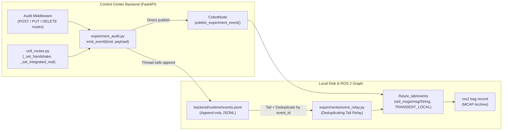

# Audit Logging & Event Pipeline (`future_lab.event.v1`)

To make every experimental run auditable and deterministic, the Control Center implements a dual-sink structured event pipeline (`future_lab_control_center/backend/experiment_audit.py` and `experiments/event_relay.py`).

---

## Event Architecture



---

## Event Schema (`future_lab.event.v1`)

Every call to `emit_event(kind, payload)` (`backend/experiment_audit.py`) constructs a self-contained JSON record with three clocks (ISO-8601 UTC wall clock, Unix epoch seconds, and monotonic nanoseconds):

```json
{
  "schema": "future_lab.event.v1",
  "event_id": "f47ac10b-58cc-4372-a567-0e02b2c3d479",
  "timestamp_utc": "2026-08-15T14:22:10.412839+00:00",
  "unix_time_s": 1786803730.412839,
  "monotonic_ns": 89124578192041,
  "kind": "handshake_transition",
  "payload": {
    "phase": "releasing_item",
    "active": true,
    "run_id": "8c19e3a2",
    "canonical_class": "tin_valid_blue",
    "target": "delivery_blue"
  }
}
```

### Emitted Event Kinds

| `kind` | Source | Description |
| :--- | :--- | :--- |
| **`http_mutation`** | `backend/main.py` middleware | Logged automatically for every `POST`, `PUT`, `PATCH`, or `DELETE` HTTP request to `/api/v1/*` (records path, method, query params, HTTP status code, and duration). |
| **`handshake_transition`** | `cell_routes.py` (`_set_handshake`) | Emitted on every phase change of the 8-stage physical handshake (`moving_scan`, `yolo_detected`, `starting_turtlebot`, `cobot_picking`, `cobot_placing`, `waiting_turtlebot_pickup`, `releasing_item`, `cobot_returning_home`, `waiting_delivery_and_dock`, `completed`, `rollback`, `failed`). |
| **`integrated_real_transition`** | `cell_routes.py` (`_set_integrated_real`) | Emitted on every phase change of `Integrated Real Mode` (`starting_moveit`, `starting_3d`, `starting_yolo`, `moving_scan`, `detecting_yolo`, `awaiting_confirm`, `running_handshake`, `completed`, `failed`). |
| **`trial_marker`** | `experiments/record_trial.sh` | Emitted at `trial_start` and `trial_end` with `trial_id`, `campaign`, `condition`, `run`, `can_color`, and `mode`. |

---

## Deduplicating ROS 2 Relay (`experiments/event_relay.py`)

During a trial recording (`record_trial.sh`), `experiments/event_relay.py` runs as a background node (`future_lab_event_relay`) on `ROS_DOMAIN_ID=0`:

1. Subscribes to `/future_lab/events` (`QoSProfile(depth=50, reliability=RELIABLE, durability=TRANSIENT_LOCAL)`) and records every `event_id` already seen on the ROS graph in an in-memory `seen_ids` set.
2. Tails `future_lab_control_center/backend/runtime/events.jsonl` every `100 ms` (`0.1 s` timer).
3. If an event was written to `events.jsonl` before or during the run and has not yet appeared on `/future_lab/events`, `event_relay.py` publishes it to `/future_lab/events` so that the MCAP rosbag is guaranteed to contain every backend event without duplicates.

---

## Configuring the Event Log Path

By default, events are appended to:

```text
future_lab_control_center/backend/runtime/events.jsonl
```

You can override this path by setting `FUTURE_LAB_EVENT_LOG=/custom/path/events.jsonl` in the backend environment.
